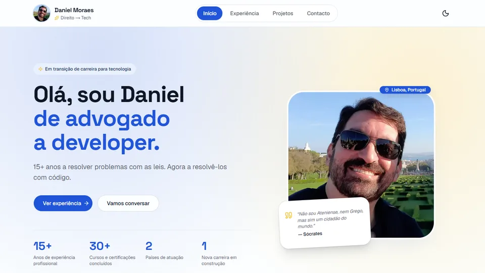

<div align="center">

# Daniel Moraes — Portfólio

**De advogado a developer.** 15+ anos a resolver problemas com as leis — agora a resolvê-los com código.

[](https://danielfm-portfolio.vercel.app/)
[](https://nextjs.org/)
[](https://react.dev/)
[](https://www.typescriptlang.org/)
[](https://tailwindcss.com/)

[**Ver site ao vivo →**](https://danielfm-portfolio.vercel.app/)



</div>

---

## Sobre o projeto

Portfólio pessoal que apresenta a minha trajetória de transição de carreira — do Direito para o desenvolvimento Frontend. Mais do que uma vitrine, é o meu **laboratório**: o lugar onde aplico, testo e consolido o que aprendo no Programa UPskill (Faculdade de Ciências da Universidade de Lisboa) e nas formações da Alura — estruturas, serviços, padrões de layout e boas práticas.

## Funcionalidades

| Área | O que tem |
| --- | --- |
| **Início** | Hero com destaques numéricos, sobre mim, formação académica e técnica com estado de conclusão, formação UPskill em destaque com modal dos módulos, certificações agrupadas com modal de detalhes e hobbies |
| **Hobbies** | Carrossel *coverflow* próprio — cards vizinhos desfocados em profundidade, setas e indicadores, ícone por tema, vídeos que só tocam quando visíveis |
| **Experiência** | Timeline do percurso profissional (Brasil e Portugal), incluindo o estágio em desenvolvimento Frontend na Faculdade de Ciências da Universidade de Lisboa |
| **Projetos** | Destaques com screenshot, selo "No ar", stack e links de demo/código, mais uma secção de projetos só no GitHub |
| **Contacto** | Formulário funcional com seleção de tema em cards, validação, proteção antispam e feedback por toast |
| **Global** | Modo claro/escuro automático ou manual, layout responsivo do mobile ao desktop, animações de entrada, favicon e ícone Apple personalizados |

## Stack

| Camada | Tecnologia |
| --- | --- |
| Framework | [Next.js 16](https://nextjs.org/) — App Router, Server Components, Turbopack |
| UI | [React 19](https://react.dev/) + [TypeScript](https://www.typescriptlang.org/) |
| Estilos | [Tailwind CSS v4](https://tailwindcss.com/) com design tokens em OKLCH |
| Componentes | [shadcn/ui](https://ui.shadcn.com/) sobre primitivas [Base UI](https://base-ui.com/) |
| Animação | [Motion](https://motion.dev/) |
| Ícones | [Lucide](https://lucide.dev/) |
| Tema | [next-themes](https://github.com/pacocoursey/next-themes) |
| Notificações | [Sonner](https://sonner.emilkowal.ski/) |
| Formulário | [Formspree](https://formspree.io/) |
| Deploy | [Vercel](https://vercel.com/) — deploy contínuo a cada push na `master` |

## Decisões técnicas

- **Conteúdo orientado a dados** — todo o texto do site (perfil, experiências, formação, certificações, projetos, hobbies) vive em [`src/lib/data.ts`](src/lib/data.ts). Atualizar o portfólio é editar um ficheiro, sem tocar em componentes.
- **Server Components por omissão** — as páginas são renderizadas no servidor e geradas como estáticas; só os componentes interativos (carrossel, formulário, tema, menu) são Client Components.
- **Zero dependências desnecessárias** — o carrossel de hobbies foi construído com Motion (já presente no projeto) e `ResizeObserver`, sem biblioteca de carrossel extra.
- **Performance de média** — vídeos com `preload="metadata"` e reprodução controlada por `IntersectionObserver`; screenshots dos projetos em WebP (≈ 20–35 KB cada); imagens servidas via `next/image`.
- **Formulário sem backend próprio** — envio via `fetch` para o Formspree, endpoint em variável de ambiente, campo *honeypot* contra bots e tratamento de erro com feedback ao utilizador.
- **Privacidade** — o endereço de e-mail não aparece como texto visível na página, reduzindo a exposição a *scrapers*.
- **Acessibilidade** — HTML semântico, `aria-label` nos controlos do carrossel e links de ícone, `aria-pressed` na seleção de tema do formulário.

## Estrutura

```
src/
├── app/
│   ├── page.tsx              # Início
│   ├── experiencia/          # Timeline profissional
│   ├── projetos/             # Projetos em destaque e no GitHub
│   ├── contacto/             # Formulário e canais de contacto
│   ├── layout.tsx            # Layout raiz: header, footer, tema, fontes
│   ├── globals.css           # Design tokens (claro/escuro)
│   ├── icon.png              # Favicon
│   └── apple-icon.png        # Ícone para ecrã inicial iOS
├── components/
│   ├── ui/                   # Componentes shadcn/ui
│   ├── hobbies-carousel.tsx  # Carrossel coverflow dos hobbies
│   ├── hobby-video.tsx       # Vídeo com play/pause por visibilidade
│   ├── certifications-grid.tsx
│   ├── contact-form.tsx
│   ├── site-header.tsx
│   ├── site-footer.tsx
│   └── reveal.tsx            # Animação de entrada
└── lib/
    └── data.ts               # Todo o conteúdo do site
```

## Como executar

**Pré-requisitos:** Node.js 20+ e npm.

```bash
git clone https://github.com/DanielMoraesTI/novo_portfolio.git
cd novo_portfolio
npm install
cp .env.example .env.local   # e preencher o endpoint (ver abaixo)
npm run dev                  # http://localhost:3000
```

| Script | Descrição |
| --- | --- |
| `npm run dev` | Servidor de desenvolvimento |
| `npm run build` | Build de produção |
| `npm run start` | Serve o build de produção |
| `npm run lint` | ESLint |

### Variáveis de ambiente

| Variável | Descrição |
| --- | --- |
| `NEXT_PUBLIC_FORMSPREE_ENDPOINT` | URL do formulário criado em [formspree.io](https://formspree.io/), ex.: `https://formspree.io/f/xxxxxxx` |

Sem esta variável, o formulário mostra uma mensagem amigável em vez de enviar. Em produção, configurar a mesma variável na Vercel em **Project Settings → Environment Variables**.

## Outros projetos

| Projeto | Descrição | Links |
| --- | --- | --- |
| **GameVault** | Catálogo pessoal de jogos com autenticação, dashboard e exportação CSV/XLSX/PDF | [Demo](https://listajogos.vercel.app) · [Código](https://github.com/DanielMoraesTI/lista_jogos) |
| **Meu Capital** | Gestão de investimentos com autenticação, Neon (Postgres) e IA | [Demo](https://meucapitalbr.vercel.app/auth) · [Código](https://github.com/DanielMoraesTI/finance-investments) |

## Contacto

[](https://www.linkedin.com/in/daniel-fernandes-de-moraes-8118b3204)
[](https://github.com/DanielMoraesTI)
[](mailto:ti.danielmoraes@gmail.com)

---

<div align="center">

© 2025–2026 Daniel Moraes · Feito com Next.js, React e café ☕ · Lisboa, Portugal

</div>
